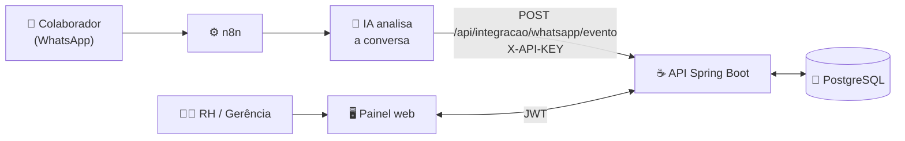
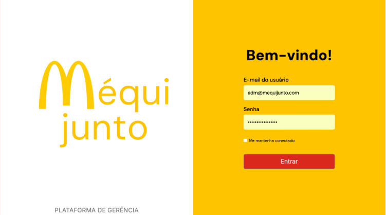
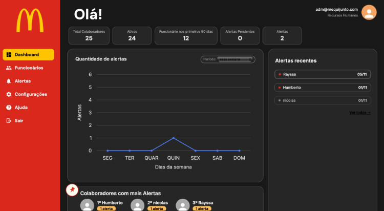
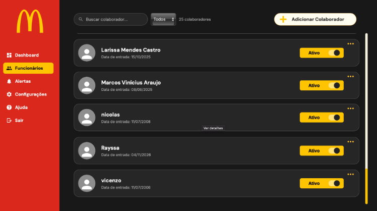
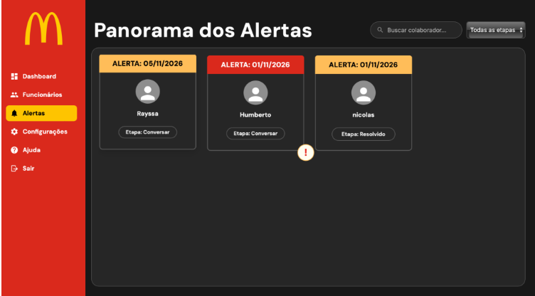
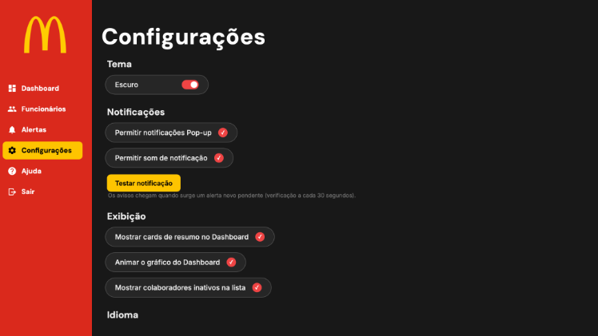
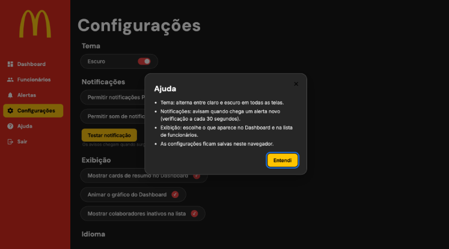

<div align="center">

# 🤝 MéquiJunto

**Plataforma de escuta, acolhimento e acompanhamento de colaboradores.**

Conversa por WhatsApp, análise por IA e um painel para o RH cuidar de quem precisa, antes que o problema cresça.

---

## 👥 Equipe

Projeto desenvolvido pela equipe **MéquiJunto** no **Desafio GC**, do programa **Geração Caldeira**, para a empresa **Kallopolli**.

| Integrantes |
|---|
| Humberto Barreto |
| Rayssa Ribeiro |
| Vicenzo Brum |
| Nicolas Kreling |
| Pedro Moreira |


<br>


**Desafio GC · Programa Geração Caldeira · Empresa Kallopolli**


</div>

---

## 📑 Sumário

- [Sobre o projeto](#-sobre-o-projeto)
- [Como funciona](#-como-funciona)
- [Funcionalidades](#-funcionalidades)
- [Telas](#-telas)
- [Tecnologias](#-tecnologias)
- [Estrutura do projeto](#-estrutura-do-projeto)
- [Primeiros passos](#-primeiros-passos)
- [Referência da API](#-referência-da-api)
- [Integração com n8n e WhatsApp](#-integração-com-n8n-e-whatsapp)
- [Privacidade e segurança](#-privacidade-e-segurança)
- [Equipe](#-equipe)

---

## 💛 Sobre o projeto

O **MéquiJunto** nasceu no **Desafio GC**, do programa **Geração Caldeira**, para responder ao desafio proposto pela **Kallopolli**: facilitar o acolhimento dos colaboradores e apoiar o acompanhamento de situações que pedem atenção.

A solução junta três peças:

- 💬 **Um canal de conversa no WhatsApp**, onde o colaborador fala com naturalidade;
- 🤖 **Uma IA** que identifica sinais que merecem cuidado, como sobrecarga;
- 🖥️ **Um painel web** em que RH e Gerência acompanham os alertas e registram o retorno dado a cada pessoa.

---

## 🔄 Como funciona



1. O colaborador conversa pelo WhatsApp.
2. O **n8n** envia a conversa para a IA e recebe a análise.
3. O n8n avisa a API do MéquiJunto sobre o resultado, com ou sem alerta.
4. Se há alerta, ele aparece como **pendente** no painel, e o RH ou a Gerência assume, acompanha e registra o retorno.

---

## ✨ Funcionalidades

| | Recurso | O que faz |
|---|---|---|
| 🔐 | **Login com JWT** | Acesso restrito aos perfis **RH** e **Gerência**. A sessão dura 8 horas. |
| 📊 | **Dashboard** | Total de colaboradores, ativos, quem está nos primeiros 90 dias, alertas pendentes e total de alertas, com gráfico de alertas por dia da semana, lista de alertas recentes e ranking dos colaboradores com mais alertas. |
| 👥 | **Funcionários** | Cadastro, edição e desativação de colaboradores, com busca, filtro, cargo, escala de trabalho (`5x2`, `4x3` ou `12x36`), idade, gênero e data de ingresso. |
| 🚨 | **Alertas** | Acompanhamento por etapa (**Pendente → Conversar → Resolvido**), com filtro, a análise da IA, o responsável e a observação de retorno. Na API, as etapas são `PENDENTE`, `EM_ANALISE` e `RESOLVIDO`. |
| 🔔 | **Notificações** | Aviso em pop-up e com som quando surge um alerta novo pendente. A verificação acontece a cada 30 segundos. |
| ⚙️ | **Preferências** | Tema claro ou escuro, e o que aparece no dashboard e na lista de funcionários. As escolhas ficam salvas no navegador. |
| 📖 | **Swagger / OpenAPI** | Documentação interativa de toda a API. |

---

## 📸 Telas

<table>
  <tr>
    <td align="center" width="50%">
      <br>
      <sub><b>Login</b></sub>
    </td>
    <td align="center" width="50%">
      <br>
      <sub><b>Dashboard</b></sub>
    </td>
  </tr>
  <tr>
    <td align="center">
      <br>
      <sub><b>Funcionários</b></sub>
    </td>
    <td align="center">
      <br>
      <sub><b>Panorama dos alertas</b></sub>
    </td>
  </tr>
  <tr>
    <td align="center">
      <br>
      <sub><b>Configurações</b></sub>
    </td>
    <td align="center">
      <br>
      <sub><b>Ajuda</b></sub>
    </td>
  </tr>
</table>

---

## 🧰 Tecnologias

| Camada | Tecnologias |
|---|---|
| **Backend** | Java 21, Spring Boot 4.1.2, Spring Web MVC, Spring Data JPA, Spring Security (OAuth2 Resource Server com JWT HS256), Bean Validation, Lombok |
| **Banco de dados** | PostgreSQL |
| **Frontend** | HTML, CSS e JavaScript puros, sem build e sem framework |
| **Automação** | n8n, WhatsApp e IA |
| **Documentação** | springdoc-openapi (Swagger UI) |

---

## 📁 Estrutura do projeto

```text
MequiJunto/
├── back/                              # API Spring Boot
│   ├── pom.xml
│   ├── mvnw / mvnw.cmd                # Maven Wrapper (não precisa instalar o Maven)
│   └── src/main/
│       ├── java/com/dev/kallopolli/mequijunto/
│       │   ├── config/                # Segurança (JWT e CORS), OpenAPI, admin inicial
│       │   ├── controller/            # Endpoints REST
│       │   ├── converter/             # Conversão da escala de trabalho
│       │   ├── dto/                   # Requests e responses
│       │   ├── entity/                # Usuario e Alerta
│       │   ├── enums/                 # EscalaTrabalho
│       │   ├── exceptions/            # Tratamento global de erros
│       │   ├── repository/            # Acesso a dados
│       │   ├── security/              # Geração de JWT e carga de usuários
│       │   └── service/               # Regras de negócio
│       └── resources/
│           ├── application.properties
│           └── db/migration/          # Scripts SQL de evolução do banco
└── front/                             # Interface web
    ├── index.html                     # Login
    ├── dashboard.html
    ├── colaboradores.html
    ├── alertas.html
    ├── configuracoes.html
    ├── config.js                      # URL da API
    ├── tema.js                        # Tema claro e escuro
    └── mequijunto-refatorado.css
```

---

## 🚀 Primeiros passos

### Pré-requisitos

- ☕ **Java 21**
- 🐘 **PostgreSQL**
- 🌐 **Node.js** ou **Python**, só para servir o frontend localmente

> O Maven não precisa estar instalado: o projeto já inclui o Maven Wrapper (`mvnw`).

### 1. Clone o repositório

```bash
git clone https://github.com/humbertobrrt/MequiJunto.git
cd MequiJunto
```

### 2. Prepare o banco de dados

Crie um banco PostgreSQL vazio e anote a URL de conexão, o usuário e a senha.

A API usa `spring.jpa.hibernate.ddl-auto=validate`: ela **confere** o schema na inicialização, mas **não o cria**. As tabelas `usuarios` e `alertas` precisam existir antes de subir o backend.

<details>
<summary><b>📄 Ver SQL de referência das tabelas</b></summary>

<br>

Este SQL foi derivado das entidades JPA (`Usuario` e `Alerta`). Se o seu banco já existe, compare com ele antes de executar.

```sql
CREATE TABLE usuarios (
    id                BIGSERIAL PRIMARY KEY,
    nome              VARCHAR(255) NOT NULL,
    telefone          VARCHAR(255),
    cargo             VARCHAR(255),
    ativo             BOOLEAN DEFAULT TRUE,
    idade             INTEGER,
    genero            VARCHAR(255),
    data_ingresso     DATE,
    email             VARCHAR(255),
    senha_hash        TEXT,
    perfil_acesso     VARCHAR(20) DEFAULT 'COLABORADOR',
    escala            VARCHAR(10),
    ultima_interacao  TIMESTAMPTZ,
    CONSTRAINT usuarios_escala_check
        CHECK (escala IS NULL OR escala IN ('5x2', '4x3', '12x36'))
);

CREATE TABLE alertas (
    id                  BIGSERIAL PRIMARY KEY,
    usuario_id          BIGINT NOT NULL REFERENCES usuarios (id),
    created_at          TIMESTAMPTZ NOT NULL DEFAULT now(),
    tipo_sinal          VARCHAR(100),
    analise_ia          TEXT NOT NULL,
    destino_alerta      VARCHAR(100),
    status_alerta       VARCHAR(20) NOT NULL DEFAULT 'PENDENTE',
    responsavel_id      BIGINT REFERENCES usuarios (id),
    retorno_em          TIMESTAMPTZ,
    observacao_retorno  TEXT
);
```

Para quem já tem a tabela `usuarios` sem a coluna `escala`, o script `back/src/main/resources/db/migration/V2__adicionar_escala_trabalho.sql` adiciona a coluna e a restrição. Ele **não é aplicado automaticamente**, então rode-o manualmente.

</details>

### 3. Configure as variáveis de ambiente

Crie o arquivo `back/.env`:

```env
# Banco de dados
DB_URL=jdbc:postgresql://localhost:5432/NOME_DO_BANCO
DB_USERNAME=USUARIO_DO_BANCO
DB_PASSWORD=SENHA_DO_BANCO

# Segurança
JWT_SECRET=CHAVE_EM_BASE64
WHATSAPP_API_KEY=CHAVE_FORTE_DA_INTEGRACAO

# Frontend (origem liberada no CORS)
FRONTEND_URL=http://localhost:5500
```

| Variável | Obrigatória | Descrição |
|---|:---:|---|
| `DB_URL` | ✅ | URL JDBC do PostgreSQL |
| `DB_USERNAME` | ✅ | Usuário do banco |
| `DB_PASSWORD` | ✅ | Senha do banco |
| `JWT_SECRET` | ✅ | Chave de assinatura dos tokens. **Precisa estar em Base64 e ter pelo menos 32 bytes.** |
| `WHATSAPP_API_KEY` | ✅ para a integração | Chave exigida no cabeçalho `X-API-KEY` do webhook. Se ficar vazia, o webhook responde `401`. |
| `FRONTEND_URL` | ➖ | Origem permitida no CORS. Padrão: `http://localhost:3000` |
| `PORT` | ➖ | Porta da API. Padrão: `8080` |

Para gerar uma `JWT_SECRET` válida:

```bash
openssl rand -base64 32
```

> ⚠️ **Nunca publique o `.env`.** Ele já está no `.gitignore`.

### 4. Crie o primeiro usuário de acesso

Os colaboradores **não têm login** na plataforma web. Só RH e Gerência entram. Para criar o primeiro acesso, adicione ao `back/.env`:

```env
BOOTSTRAP_ADMIN_ENABLED=true
BOOTSTRAP_ADMIN_NOME=Seu Nome
BOOTSTRAP_ADMIN_EMAIL=voce@empresa.com
BOOTSTRAP_ADMIN_PASSWORD=UmaSenhaForte123
BOOTSTRAP_ADMIN_PERFIL=RH
```

O perfil aceita `RH` ou `GERENCIA`. Há também a variável opcional `BOOTSTRAP_ADMIN_TELEFONE`.

> ⚠️ Não escreva comentários na mesma linha de um valor no `.env` (por exemplo `PERFIL=RH # texto`). O arquivo é lido como `.properties`, e o comentário passaria a fazer parte do valor.

O usuário é criado na inicialização e só se o e-mail ainda não existir. Depois do primeiro acesso, **volte `BOOTSTRAP_ADMIN_ENABLED` para `false`** e remova a senha do arquivo.

### 5. Suba o backend

```bash
cd back

# Linux e macOS (na primeira vez, dê permissão de execução ao wrapper)
chmod +x mvnw
./mvnw spring-boot:run
```

```bat
:: Windows
mvnw.cmd spring-boot:run
```

| Recurso | Endereço |
|---|---|
| API | http://localhost:8080 |
| Swagger UI | http://localhost:8080/swagger-ui.html |

### 6. Suba o frontend

Em outro terminal, na raiz do projeto, use **uma** das opções:

```bash
# Node.js
npx --yes http-server ./front -p 5500
```

```bash
# Python
python -m http.server 5500 --directory front
```

Abra http://localhost:5500 e entre com o usuário criado no passo 4.

> 💡 A URL da API usada pelo frontend fica em [`front/config.js`](front/config.js). Para apontar para outro ambiente, altere a constante `MJ_API`. Se mudar a porta do frontend, atualize também `FRONTEND_URL` no `.env` e reinicie o backend.

---

## 📡 Referência da API

A documentação completa e interativa está no **Swagger UI**. Este é o resumo:

🔓 público · 🔑 JWT (perfil `RH` ou `GERENCIA`) · 🗝️ `X-API-KEY`

| Acesso | Método | Rota | Descrição |
|:---:|:---:|---|---|
| 🔓 | `POST` | `/api/auth/login` | Autentica e devolve o token JWT |
| 🔑 | `GET` | `/api/dashboard/resumo` | Indicadores do painel |
| 🔑 | `GET` | `/api/usuarios` | Lista os colaboradores |
| 🔑 | `GET` | `/api/usuarios/{id}` | Busca um colaborador |
| 🔑 | `POST` | `/api/usuarios` | Cadastra um colaborador |
| 🔑 | `PUT` | `/api/usuarios/{id}` | Atualiza um colaborador |
| 🔑 | `PATCH` | `/api/usuarios/{id}/desativar` | Desativa um colaborador |
| 🔑 | `GET` | `/api/alertas?status=` | Lista alertas, com filtro opcional de status |
| 🔑 | `PATCH` | `/api/alertas/{id}/retorno` | Atualiza o status e registra o retorno |
| 🗝️ | `POST` | `/api/integracao/whatsapp/evento` | Recebe eventos do n8n |

### Autenticação

```bash
curl -X POST http://localhost:8080/api/auth/login \
  -H "Content-Type: application/json" \
  -d '{"email": "voce@empresa.com", "senha": "UmaSenhaForte123"}'
```

```json
{
  "token": "eyJhbGciOiJIUzI1NiJ9...",
  "tipo": "Bearer",
  "expiresIn": 28800
}
```

Use o token nas demais chamadas:

```http
Authorization: Bearer <token>
```

### Cadastrar colaborador

```json
{
  "nome": "Maria Silva",
  "telefone": "(51) 99999-9999",
  "cargo": "Atendente",
  "escala": "5x2",
  "idade": 28,
  "genero": "Feminino",
  "dataIngresso": "2026-09-01"
}
```

O telefone é normalizado para conter apenas dígitos e deve ser único.

### Registrar o retorno de um alerta

```json
{
  "statusAlerta": "EM_ANALISE",
  "responsavelId": 1,
  "observacaoRetorno": "Conversa agendada com o colaborador para quinta-feira."
}
```

O responsável precisa ser um usuário **ativo** com perfil **RH** ou **Gerência**.

---

## 🔌 Integração com n8n e WhatsApp

O backend expõe um endpoint para receber os eventos gerados pelo fluxo do n8n:

```http
POST /api/integracao/whatsapp/evento
Content-Type: application/json
X-API-KEY: SUA_CHAVE_DE_INTEGRACAO
```

A chave enviada no cabeçalho deve ser igual à `WHATSAPP_API_KEY` configurada no backend.

**Evento sem alerta.** Apenas atualiza a última interação do colaborador:

```json
{
  "telefone": "51999999999",
  "alertaIdentificado": false
}
```

**Evento com alerta.** Cria um alerta com status `PENDENTE`:

```json
{
  "telefone": "51999999999",
  "alertaIdentificado": true,
  "tipoSinal": "SOBRECARGA",
  "analiseIa": "A IA identificou sinais que precisam de acompanhamento pelo RH.",
  "destinoAlerta": "RH"
}
```

**Resposta** (`201 Created`):

```json
{
  "alertaCriado": true,
  "alertaId": 42,
  "usuarioId": 7
}
```

| Código | Quando acontece |
|:---:|---|
| `201` | Evento registrado |
| `400` | Telefone inválido, ou alerta enviado sem `analiseIa` |
| `401` | `X-API-KEY` ausente ou incorreta |
| `404` | Nenhum colaborador **ativo** com esse telefone |

> O telefone precisa corresponder a um colaborador ativo cadastrado. A comparação ignora máscara e usa só os dígitos.

---

## 🔒 Privacidade e segurança

- 🗣️ **O backend não guarda mensagens nem histórico de conversa.** Ele armazena apenas os alertas identificados e a data da última interação.
- 🔑 As senhas são salvas com **BCrypt**.
- 🎟️ Os tokens JWT são assinados com **HS256** e expiram em **8 horas**.
- 🛡️ A chave do webhook é comparada em **tempo constante**.
- 🌐 O **CORS** libera apenas a origem definida em `FRONTEND_URL`.
- 🤫 Mantenha senhas, tokens e chaves fora do repositório, do frontend e dos fluxos do n8n.
- 🔐 Em produção, use **HTTPS** e variáveis de ambiente com valores fortes.


---

<div align="center">

Feito com 💛 para cuidar de quem cuida.

</div>
